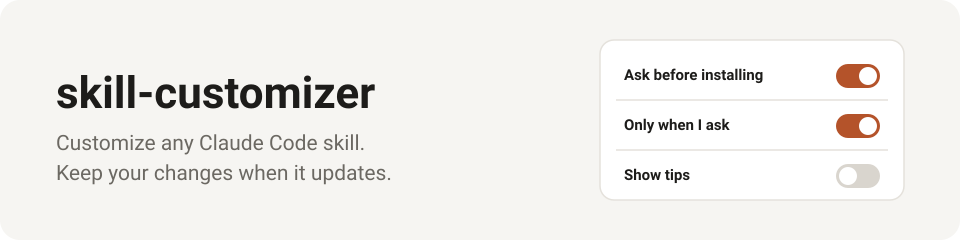
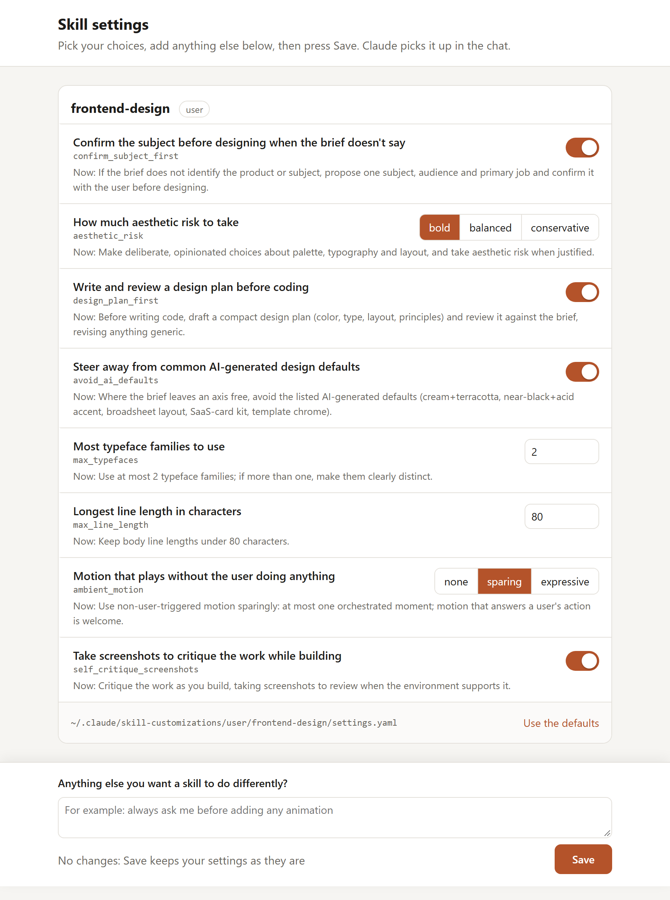
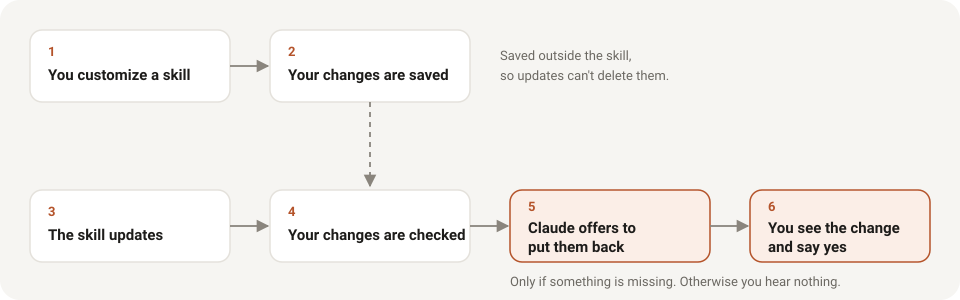
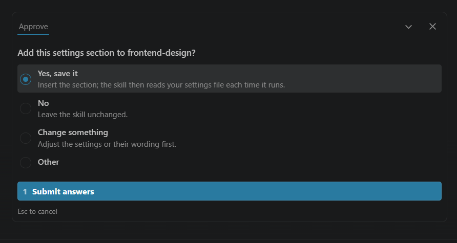

<p align="center">
  
</p>

<p align="center">
  <a href="https://github.com/manasvimittal-22/skill-customizer/releases"></a>
  <a href="LICENSE"></a>
  
  
</p>

> **Early version.** It works and it's tested, but it's new. If something looks wrong, please [open an issue](https://github.com/manasvimittal-22/skill-customizer/issues).

## The problem

You install a skill. You change it a little so it works your way. Then the skill updates, and **your changes are gone**.

## The fix

skill-customizer turns a skill's behaviour into simple settings you can switch on and off. It remembers every change you make. When the skill updates, it **puts your changes back**.

<p align="center">
  <picture>
    <source media="(prefers-color-scheme: dark)" srcset="assets/settings-page-dark.png">
    
  </picture>
  <br>
  <sub>The settings page for the <code>frontend-design</code> skill. Every switch is something the skill does.</sub>
</p>

## Install

**Recommended: as a Claude Code plugin.** You get everything, including the update check.

```
/plugin marketplace add manasvimittal-22/skill-customizer
/plugin install skill-customizer@skill-customizer
```

Then start a new Claude Code session.

<details>
<summary>Other ways to install</summary>

**From a terminal** (for example if `/plugin` isn't available in your chat):

```bash
claude plugin marketplace add manasvimittal-22/skill-customizer
claude plugin install skill-customizer@skill-customizer
```

**Only the skill**, with the skills CLI. No panel, and the update check runs when you use the skill:

```bash
npx skills add manasvimittal-22/skill-customizer
```

With this install, the command is `/customize` instead of `/skill-customizer:customize`.

You need Node.js 22 or newer.

</details>

## Quick start

1. **Ask for it:** type `/skill-customizer:customize` and the name of a skill, for example `/skill-customizer:customize frontend-design`.
2. **Answer two quick questions** (only the first time): where you want to change settings, and how.
3. **Look and say yes:** Claude reads the skill, finds what it does, and shows you exactly what it will add. Nothing changes until you say yes.

After that, change settings whenever you like. No more rewriting.

## Four ways to change settings

|     | Where                     | Good for                                                                |
| --- | ------------------------- | ----------------------------------------------------------------------- |
| 💬  | **Pop-ups in the chat**   | Quick choices without leaving the chat                                  |
| 🌐  | **Settings page**         | Seeing every setting at once in your browser. Pick, then press **Save** |
| 🧩  | **Panel beside the chat** | Keeping your settings open while you work (plugin install only)         |
| 📝  | **Settings file**         | Editing a simple text file yourself. No Claude needed                   |

On the settings page there is also a box for **anything a switch doesn't cover**. Write it in your own words, press Save, and Claude takes it from there in the chat.

## What happens when a skill updates

<p align="center">
  
</p>

- **Checked automatically** each time you start Claude Code. You only hear about it when something needs your attention.
- **Reworded by the update?** Claude applies what you wanted to the new wording, and shows you the result first.
- **The update already does what you wanted?** Claude offers to stop tracking that change.

## You stay in control

<p align="center">
  
</p>

- **You see every change first.** Claude shows the before and after, and waits for your yes.
- **Undo always works.** A backup is kept before every change: `/skill-customizer:customize undo <skill>`.
- **Your data stays on your computer.** Nothing is sent anywhere. The settings page runs only on your own computer and needs a secret link to open. See [SECURITY.md](SECURITY.md).

## All commands

| Type this                                  | What it does                                                 |
| ------------------------------------------ | ------------------------------------------------------------ |
| `/skill-customizer:customize <skill>`      | Customize a skill                                            |
| `/skill-customizer:customize settings`     | Open your settings for all customized skills                 |
| `/skill-customizer:customize status`       | See your customized skills and anything that needs attention |
| `/skill-customizer:customize undo <skill>` | Undo the last change                                         |
| `/skill-customizer:customize setup`        | Change where and how you customize                           |
| `/skill-settings`                          | Open the panel beside the chat (plugin install only)         |

## Questions

<details>
<summary><b>Which skills can I customize?</b></summary>

Any skill Claude Code can use: your own skills (`~/.claude/skills`), a project's skills (`.claude/skills`) and skills from plugins. It can even customize itself.

</details>

<details>
<summary><b>Does it slow down my skills or cost more?</b></summary>

A customized skill reads one small settings file when it runs (roughly 100 to 200 tokens). Changing a setting later costs nothing. The update check at the start of a session costs nothing unless something changed.

</details>

<details>
<summary><b>Where are my settings kept?</b></summary>

In `~/.claude/skill-customizations/`, outside the skills themselves, so updates can't remove them:

```
~/.claude/skill-customizations/<scope>/<skill>/
├── settings.yaml   your values (you can edit this)
├── schema.json     which settings exist and what each one does
├── record.json     every change you made
├── CHANGES.md      the same, easy to read
└── backups/
```

</details>

<details>
<summary><b>How do I remove it?</b></summary>

Run `/skill-customizer:customize undo <skill>` until each skill is back to how it was, then uninstall the plugin (`/plugin uninstall skill-customizer@skill-customizer`). Your settings folder stays until you delete it.

</details>

## License

[MIT](LICENSE)
